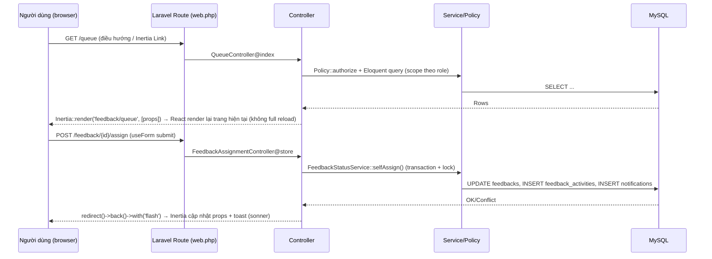
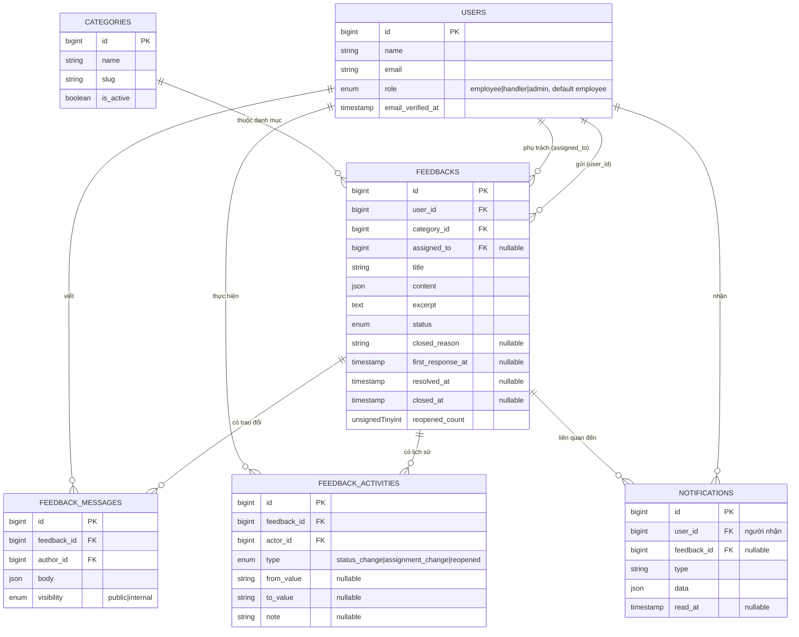

# Thiết kế kỹ thuật MVP — Hệ thống tiếp nhận & xử lý góp ý nội bộ

Stack: Laravel 13 (Inertia.js) + React 19 + Tiptap, trên nền **Laravel React Starter Kit** đã có sẵn trong repo (Fortify cho auth, Wayfinder cho route/action type-safe, shadcn/ui "new-york" + Radix + Tailwind v4).

## 0. Giả định & phạm vi

### Phạm vi MVP (nhắc lại)
- Nhân viên đã đăng nhập gửi góp ý (tiêu đề, nội dung Tiptap, danh mục), xem góp ý/tiến độ/phản hồi của mình, bổ sung thông tin qua trao đổi.
- Đội xử lý có hàng đợi chung, mỗi góp ý tối đa 1 người phụ trách chính; trả lời người gửi hoặc ghi chú nội bộ.
- Quản trị viên quản lý vai trò, danh mục, phân công, xem tổng quan hệ thống.
- Không có: bảng góp ý công khai, bình chọn, tệp đính kèm, SLA tự động. Một hàng đợi nội bộ dùng chung.

### Giả định ảnh hưởng thiết kế

| # | Giả định | Lý do |
|---|---|---|
| A1 | 3 vai trò cố định lưu bằng cột `role` enum trên `users`: `employee` (mặc định), `handler`, `admin`. Không dùng package phân quyền (Spatie...). | MVP chỉ cần 3 vai trò tĩnh, không cần permission linh hoạt theo từng hành động — enum đơn giản, dễ bảo trì, đủ cho Policy kiểm tra `$user->role`. |
| A2 | Mọi người dùng (kể cả handler/admin) đều có thể tự gửi góp ý — vai trò chỉ quyết định họ thấy/xử lý được gì thêm, không hạn chế việc gửi. | Trong tổ chức thật, quản trị viên/đội xử lý cũng là nhân viên có thể góp ý. |
| A3 | Nội dung Tiptap là nguồn dữ liệu gốc duy nhất (JSON), không lưu thêm bản HTML. Hiển thị luôn qua Tiptap renderer phía React (schema-based), không `dangerouslySetInnerHTML` với HTML tự tạo. | Tránh phải xây dựng và duy trì một bộ HTML sanitizer riêng; ProseMirror schema của Tiptap tự giới hạn cấu trúc DOM được sinh ra. |
| A4 | Ghi chú nội bộ không phải bảng riêng mà là cột `visibility` (`public`/`internal`) trên bảng trao đổi (`feedback_messages`). | Đơn giản hơn 2 bảng riêng, vẫn đủ để lọc ở tầng query. |
| A5 | Lịch sử xử lý (chuyển trạng thái + đổi người phụ trách + mở lại) hợp nhất trong **một** bảng `feedback_activities`, không tách nhiều bảng lịch sử. | Một nguồn duy nhất cho timeline hiển thị và cho tính chỉ số dashboard theo thời gian. |
| A6 | Thông báo trong ứng dụng là bản ghi DB (`notifications`), không có bảng góp ý công khai hay real-time/WebSocket; người dùng thấy thông báo mới khi Inertia tải lại trang (poll nhẹ ở header, ví dụ mỗi 30–60s hoặc khi điều hướng). | Ngoài phạm vi MVP, tránh thêm hạ tầng broadcast. |
| A7 | DB là MySQL (theo `.env` hiện tại của repo) — dùng kiểu cột `JSON` chuẩn MySQL 8, không phải JSONB của Postgres. | Khớp hạ tầng thực tế của dự án. |
| A8 | Dashboard tính trực tiếp bằng aggregate query trên bảng chính, không có bảng tổng hợp (materialized) riêng. | Quy mô dữ liệu nội bộ MVP còn nhỏ, chưa cần pre-aggregate. |
| A9 | Time bucket "theo tuần" dùng tuần ISO (Thứ 2 → Chủ nhật) theo timezone ứng dụng (`config('app.timezone')`, đề xuất đặt `Asia/Ho_Chi_Minh`). | Cần một quy ước cố định để đối chiếu số liệu, tránh lệch theo UTC. |
| A10 | Sửa nội dung góp ý sau khi gửi **chỉ** cho phép khi trạng thái còn `Mới`, và chỉ người gửi được sửa. Sau khi đã được xem xét, mọi bổ sung đi qua trao đổi (thread), nội dung gốc bất biến. | Giữ tính toàn vẹn của góp ý gốc làm mốc đối chiếu lịch sử xử lý. |
| A11 | Màn hình mới tái sử dụng bộ shadcn/ui hiện có trong repo, và **bổ sung thêm** các component shadcn chưa có (table, tabs, textarea, popover, badge, calendar/date-range, command/combobox, chart block dùng Recharts) bằng `npx shadcn@latest add ...` theo đúng cấu hình sẵn có trong [components.json](../../components.json) (style `new-york`, alias `@/components/ui`, icon `lucide`) — không tự viết UI kit song song. | Theo đúng yêu cầu bổ sung của người dùng: dùng thêm thư viện shadcn thay vì viết component tuỳ biến từ đầu. |
| A12 | Danh mục (`categories`) không bị xoá cứng — chỉ `is_active = false` (ẩn khỏi lựa chọn khi tạo góp ý mới) vì góp ý cũ vẫn tham chiếu `category_id`. | Tránh lỗi khoá ngoại / mất ngữ cảnh lịch sử khi admin dọn danh mục. |
| A13 | Góp ý "Đã đóng" là nhánh kết thúc sớm (từ `Mới`/`Đang xem xét`/`Đang xử lý`) khi không giải quyết; không coi `Đã giải quyết` → `Đã đóng` là một chuyển tiếp cần thiết cho MVP (giải quyết đã là trạng thái kết thúc thành công). | Khớp đúng câu mô tả gốc "Đã đóng khi có lý do, như trùng lặp hoặc ngoài phạm vi" — áp dụng cho case không đáng xử lý tiếp, không áp dụng cho case đã xử lý xong. |

---

## 1. Kiến trúc & giao diện

### 1.1 Mô hình tích hợp Laravel–React

Dự án dùng **Inertia.js**, không phải SPA gọi REST API rời. Đường đi dữ liệu:

Nguyên tắc:
- **Trang (render)**: route `Route::inertia(...)` hoặc `Controller@index/show` trả `Inertia::render('<page>', [...])`. Props là dữ liệu đã được Policy/scope lọc sẵn ở server — React không tự quyết định được thấy gì.
- **Hành động (action)**: route `POST/PATCH/PUT/DELETE` do React gọi qua Inertia `useForm().post(...)`/`router.post(...)`, dùng hàm được **Wayfinder** sinh sẵn trong `resources/js/actions/App/Http/Controllers/...` (type-safe, không hard-code URL string). Controller xử lý xong `redirect()->back()` kèm flash message; không trả JSON API thuần (trừ 1 endpoint JSON nhỏ cho polling số thông báo chưa đọc — xem 1.3).
- **Auth**: session guard của Fortify đã có (`auth`, `verified` middleware). Không thêm Sanctum/token.
- **Phân quyền ở route**: middleware `role:handler,admin` (mới, đăng ký alias trong `bootstrap/app.php`) chặn truy cập cả **trang** dành riêng cho handler/admin (vd `/queue`, `/admin/*`) trước khi vào controller. Phân quyền **theo đối tượng** (một góp ý cụ thể, một ghi chú nội bộ cụ thể) dùng Laravel Policy trong controller — chi tiết ở mục 4.

### 1.2 Màn hình chính theo vai trò

| Vai trò | Màn hình | Mục đích |
|---|---|---|
| Nhân viên | `Gửi góp ý` (`/feedback/create`) | Form Tiptap + chọn danh mục |
| Nhân viên | `Góp ý của tôi` (`/feedback`) | Danh sách + lọc trạng thái/danh mục |
| Nhân viên | `Chi tiết góp ý` (`/feedback/{id}`) | Nội dung, timeline trạng thái (chỉ mục công khai), thread công khai, hộp trả lời bổ sung |
| Người xử lý | `Hàng đợi` (`/queue`) | Danh sách tất cả góp ý (lọc: chưa gán / của tôi / trạng thái / danh mục) |
| Người xử lý | `Chi tiết góp ý` (`/feedback/{id}`) | Giống trên + nút Nhận xử lý/Chuyển trạng thái/Đóng/Trả lời công khai/Ghi chú nội bộ |
| Người xử lý & QTV | `Dashboard` (`/dashboard`) | Số liệu theo vai trò (mục 5) |
| Quản trị viên | `Danh mục` (`/admin/categories`) | CRUD danh mục |
| Quản trị viên | `Người dùng & vai trò` (`/admin/users`) | Đổi vai trò người dùng |
| Quản trị viên | `Tất cả góp ý` (`/admin/feedback`) | Như hàng đợi nhưng toàn quyền, có nút "Đổi người phụ trách" tuỳ ý |

### 1.3 Danh sách route

Quy ước đặt tên theo đúng convention hiện có của repo (`routes/settings.php`): nhóm theo middleware, `Route::inertia` cho trang render thuần, `Controller@action` kèm `->name()` cho hành động có xử lý.

| Method | Route | Controller@action | Input chính | Quyền | Kết quả |
|---|---|---|---|---|---|
| GET | `/feedback` | `FeedbackController@index` | query: `status?`, `category_id?` | auth | Inertia `feedback/index` — danh sách góp ý **của chính người gọi** |
| GET | `/feedback/create` | `FeedbackController@create` | — | auth | Inertia `feedback/create` — props: `categories` (active) |
| POST | `/feedback` | `FeedbackController@store` | `title`, `content` (Tiptap JSON), `category_id` | auth | Tạo góp ý, `status=new`, redirect → `/feedback/{id}` |
| GET | `/feedback/{feedback}` | `FeedbackController@show` | route param | `FeedbackPolicy@view` | Inertia `feedback/show` — props lọc theo vai trò (internal note ẩn với employee) |
| PATCH | `/feedback/{feedback}` | `FeedbackController@update` | `title?`, `content?`, `category_id?` | `FeedbackPolicy@update` (chủ sở hữu + status=new) | Cập nhật nội dung gốc, redirect back |
| GET | `/queue` | `QueueController@index` | query: `status?`, `assignee?`, `category_id?` | middleware `role:handler,admin` | Inertia `feedback/queue` |
| POST | `/feedback/{feedback}/self-assign` | `FeedbackAssignmentController@selfAssign` | — | `FeedbackPolicy@selfAssign` (role handler, chưa có assignee) | `assigned_to=self`, `status=reviewing`, ghi activity, redirect back |
| PATCH | `/feedback/{feedback}/assignee` | `FeedbackAssignmentController@reassign` | `assigned_to` | `FeedbackPolicy@reassign` (role admin) | Đổi người phụ trách, ghi activity + notification cho handler mới |
| PATCH | `/feedback/{feedback}/status` | `FeedbackStatusController@update` | `to_status`, `reason?` (bắt buộc khi `closed`) | `FeedbackPolicy@changeStatus` | Chuyển trạng thái theo bảng mục 3 (3.1), transaction + lock |
| POST | `/feedback/{feedback}/reopen` | `FeedbackStatusController@reopen` | `reason` | `FeedbackPolicy@reopen` | `resolved/closed → reviewing`, `reopened_count++`, notification |
| POST | `/feedback/{feedback}/messages` | `FeedbackMessageController@store` | `body` (Tiptap JSON), `visibility` (`public` mặc định cho employee; `public`/`internal` cho handler/admin) | `FeedbackMessagePolicy@create` | Thêm trao đổi, set `first_response_at` nếu là reply công khai đầu tiên của handler, notification |
| GET | `/admin/categories` | `CategoryController@index` | — | middleware `role:admin` | Inertia `admin/categories` |
| POST | `/admin/categories` | `CategoryController@store` | `name` | `role:admin` | Tạo danh mục |
| PATCH | `/admin/categories/{category}` | `CategoryController@update` | `name?`, `is_active?` | `role:admin` | Sửa/kích hoạt-ẩn danh mục |
| GET | `/admin/users` | `UserRoleController@index` | query: `search?` | `role:admin` | Inertia `admin/users` |
| PATCH | `/admin/users/{user}/role` | `UserRoleController@update` | `role` | `role:admin` | Đổi vai trò |
| GET | `/admin/feedback` | `AdminFeedbackController@index` | query lọc tương tự `/queue` + `assignee` bất kỳ | `role:admin` | Inertia `feedback/queue` (component chia sẻ, prop `scope=admin`) |
| GET | `/dashboard` | `DashboardController@index` | — | auth | Inertia `dashboard` — props theo `auth.user.role` (mục 5) |
| GET | `/notifications/unread-count` | `NotificationController@unreadCount` | — | auth | **JSON** nhỏ `{count}` cho badge chuông, polling phía client |
| GET | `/notifications` | `NotificationController@index` | — | auth | Inertia `notifications/index` |
| POST | `/notifications/{notification}/read` | `NotificationController@markRead` | — | chủ sở hữu notification | redirect back |

> Toàn bộ route action dùng `redirect()->back()->with(['flash' => [...]])`, khớp pattern hiện có ở `ProfileController`/`SecurityController`. Riêng `/notifications/unread-count` là ngoại lệ JSON thuần vì được gọi bằng `fetch` định kỳ, không phải điều hướng Inertia.

---

## 2. Thiết kế database

### 2.1 ERD

### 2.2 Bảng schema chi tiết

**`users`** (bảng có sẵn, thêm 1 cột qua migration mới)

| Cột | Kiểu | Null | Khoá/Chỉ mục | Ghi chú |
|---|---|---|---|---|
| `role` | `enum('employee','handler','admin')` | không, default `employee` | index | Mới thêm. |

**`categories`**

| Cột | Kiểu | Null | Khoá/Chỉ mục | Ghi chú |
|---|---|---|---|---|
| `id` | bigint PK | — | — | |
| `name` | string(100) | không | unique | |
| `slug` | string(100) | không | unique | sinh từ `name` |
| `is_active` | boolean | không, default true | index | ẩn khỏi select khi tạo góp ý nếu false |
| `created_at`/`updated_at` | timestamp | — | — | |

**`feedbacks`**

| Cột | Kiểu | Null | Khoá/Chỉ mục | Ghi chú |
|---|---|---|---|---|
| `id` | bigint PK | — | — | |
| `user_id` | FK → users | không | index | người gửi |
| `category_id` | FK → categories | không | index | `restrictOnDelete` (không xoá danh mục còn tham chiếu — dùng `is_active` thay) |
| `assigned_to` | FK → users, nullable | có | index | người phụ trách chính, tối đa 1 |
| `title` | string(255) | không | — | |
| `content` | JSON | không | — | Tiptap doc gốc |
| `excerpt` | text | có | fulltext (nếu cần tìm kiếm cơ bản) | plain-text rút gọn, sinh khi lưu, dùng hiển thị danh sách/dashboard không phải parse JSON |
| `status` | `enum('new','reviewing','in_progress','resolved','closed')` | không, default `new` | index; composite `(status, assigned_to)` | |
| `closed_reason` | string(255) | có | — | bắt buộc ở tầng validate khi `status=closed` |
| `first_response_at` | timestamp | có | — | thời điểm reply **công khai** đầu tiên của handler/admin |
| `resolved_at` | timestamp | có | index | ghi đè mỗi lần chuyển sang `resolved` |
| `closed_at` | timestamp | có | — | |
| `reopened_count` | unsignedTinyInt | không, default 0 | — | |
| `created_at`/`updated_at` | timestamp | — | index `created_at` (truy vấn tuần) | |

**`feedback_messages`** (trao đổi)

| Cột | Kiểu | Null | Khoá/Chỉ mục | Ghi chú |
|---|---|---|---|---|
| `id` | bigint PK | — | — | |
| `feedback_id` | FK → feedbacks | không | index composite `(feedback_id, created_at)` | |
| `author_id` | FK → users | không | index | |
| `body` | JSON | không | — | Tiptap doc, whitelist node/mark hẹp hơn nội dung chính (mục 2.3) |
| `visibility` | `enum('public','internal')` | không, default `public` | index | |
| `created_at`/`updated_at` | timestamp | — | — | |

**`feedback_activities`** (lịch sử xử lý)

| Cột | Kiểu | Null | Khoá/Chỉ mục | Ghi chú |
|---|---|---|---|---|
| `id` | bigint PK | — | — | |
| `feedback_id` | FK → feedbacks | không | index composite `(feedback_id, created_at)` | append-only, không update/xoá |
| `actor_id` | FK → users | không | index | |
| `type` | `enum('status_change','assignment_change','reopened')` | không | index (dùng cho dashboard "giải quyết theo tuần") | |
| `from_value` | string(50) | có | — | trạng thái/người phụ trách cũ |
| `to_value` | string(50) | có | — | trạng thái/người phụ trách mới |
| `note` | string(255) | có | — | lý do đóng/mở lại nếu có |
| `created_at` | timestamp | — | index | không có `updated_at` (immutable) |

**`notifications`**

| Cột | Kiểu | Null | Khoá/Chỉ mục | Ghi chú |
|---|---|---|---|---|
| `id` | bigint PK | — | — | |
| `user_id` | FK → users | không | composite `(user_id, read_at)`, `(user_id, created_at)` | người nhận |
| `feedback_id` | FK → feedbacks, nullable | có | index | |
| `type` | string(50) | không | — | `assigned`, `new_reply`, `status_changed`, `reopened` |
| `data` | JSON | không | — | payload hiển thị (tiêu đề góp ý, tên actor...) |
| `read_at` | timestamp | có | — | |
| `created_at` | timestamp | — | — | |

### 2.3 Lưu & kiểm tra nội dung Tiptap JSON

- **Cấu trúc**: bắt buộc `{"type":"doc","content":[...]}`; validate bằng một `Rule` object tuỳ biến (`App\Rules\ValidTiptapDocument`), nhận tham số `profile` (`feedback` hoặc `message`) để áp whitelist khác nhau.
- **Whitelist node/mark**:
  - Profile `feedback` (nội dung góp ý chính): node `paragraph, heading(level 1-3), bulletList, orderedList, listItem, blockquote, codeBlock, hardBreak, text`; mark `bold, italic, underline, strike, code, link`.
  - Profile `message` (trao đổi/ghi chú): tập hẹp hơn — node `paragraph, bulletList, listItem, hardBreak, text`; mark `bold, italic, link` — đủ cho trả lời ngắn, giảm diện tích rủi ro.
  - Node/mark/attrs ngoài whitelist → **từ chối toàn bộ request** (422), không âm thầm loại bỏ, để người dùng biết và soạn lại.
- **Kiểm soát URL**: mark `link` chỉ nhận `attrs.href` có scheme `http`, `https`, `mailto`; từ chối `javascript:`, `data:`, hoặc thiếu scheme hợp lệ. Khi hiển thị, Tiptap `Link` extension được cấu hình `protocols: ['http','https','mailto']`, tự thêm `rel="noopener noreferrer nofollow" target="_blank"`.
- **Giới hạn kích thước**: so sánh `strlen(json_encode($content))` — tối đa **20 KB** cho `feedback.content`, **5 KB** cho `message.body`; vượt quá → lỗi validate rõ ràng ("Nội dung quá dài").
- **Giới hạn độ sâu**: đếm độ sâu lồng node tối đa **20** khi duyệt đệ quy, chặn payload bệnh lý (vd list lồng list hàng trăm cấp) trước khi nó tới DB hay client.
- **Hiển thị an toàn**: không server-side render ra HTML để lưu/cache; client dùng Tiptap ở chế độ `editable: false` với **đúng tập extension đã whitelist ở trên** (không thêm extension nào khác) để parse JSON → DOM qua schema ProseMirror. Vì extension bị giới hạn, bất kỳ node lạ nào (dù lọt qua do lỗi phần mềm) đơn giản là **không có renderer tương ứng** nên không sinh được DOM tuỳ ý → không thể tự thực thi script. Đây là lớp phòng vệ thứ 2 song song với validate ở server (A3).
- **Excerpt cho danh sách**: khi `store`/`update`, một hàm PHP đệ quy duyệt `content.content[].content[].text` nối chuỗi, cắt 160 ký tự, lưu vào `excerpt` — tránh phải parse JSON Tiptap ở mọi lần render danh sách.

### 2.4 Phân loại dữ liệu

| Loại | Bảng/cột | Mục đích |
|---|---|---|
| Trạng thái hiện tại | `feedbacks.status`, `assigned_to`, `resolved_at`, `closed_at`, `closed_reason`, `reopened_count` | Luôn bị ghi đè — phản ánh tình trạng mới nhất |
| Lịch sử (append-only) | `feedback_activities` (mọi dòng), `feedback_messages` (mọi dòng) | Không update/xoá, dùng cho timeline hiển thị và audit |
| Dữ liệu tính dashboard | `feedbacks.created_at/resolved_at/first_response_at/category_id/assigned_to`, `feedback_activities.type='status_change' & to_value` | Nguồn duy nhất cho mọi công thức ở mục 5 |

---

## 3. Luồng xử lý góp ý

### 3.1 Bảng chuyển trạng thái

| Trạng thái nguồn | Trạng thái đích | Vai trò thực hiện | Điều kiện bắt buộc |
|---|---|---|---|
| `new` | `reviewing` | handler (tự nhận, `assigned_to` đang null) | Chưa có người phụ trách |
| `reviewing` | `in_progress` | handler đang là `assigned_to`, hoặc admin | — |
| `in_progress` | `resolved` | handler đang là `assigned_to`, hoặc admin | Phải kèm **một trả lời công khai** (gửi cùng lúc trong form "Giải quyết", hoặc đã tồn tại ≥1 message `public` trước đó) |
| `new` / `reviewing` / `in_progress` | `closed` | handler/admin | `closed_reason` bắt buộc (enum gợi ý: `duplicate`, `out_of_scope`, `other` + mô tả) |
| `resolved` | `in_progress` (mở lại) | người gửi (chủ góp ý), hoặc handler/admin | `reason` bắt buộc; `reopened_count += 1` |
| `closed` | `reviewing` (mở lại) | **chỉ admin** | `reason` bắt buộc — dùng để sửa sai khi đóng nhầm |
| (bất kỳ trạng thái mở) | đổi `assigned_to` sang handler khác | **chỉ admin** | Trạng thái chưa `resolved`/`closed` |

Quy tắc khác:
- **Sửa nội dung góp ý**: chỉ khi `status=new` và chỉ người gửi (xem A10).
- **Tự nhận** chỉ áp dụng khi `assigned_to IS NULL`; handler không tự "cướp" góp ý đã có người phụ trách — muốn đổi phải qua admin.
- Mọi transition không nằm trong bảng trên bị chặn ở Policy (trả 403) **và** ở service layer (trả lỗi nghiệp vụ) — không chỉ ẩn nút ở UI.

### 3.2 Luồng từ gửi đến khi có kết quả

1. Nhân viên gửi góp ý → `feedbacks` tạo với `status=new`, không tạo thông báo hàng loạt cho mọi handler (hàng đợi tự hiển thị theo query `status=new`), chỉ ghi 1 dòng `feedback_activities(type=status_change, from=null, to=new)`.
2. Handler vào `/queue`, tự nhận → transaction: `UPDATE feedbacks SET assigned_to, status=reviewing` + `INSERT feedback_activities` + **không** notify người gửi ở bước này (chưa có gì đáng báo).
3. Handler bắt đầu xử lý (`in_progress`) → ghi activity; tuỳ chọn gửi `notifications` cho người gửi loại `status_changed` ("Góp ý của bạn đang được xử lý") — bật/tắt được, mặc định **có** gửi vì đây là cập nhật có ý nghĩa với người gửi.
4. Handler trả lời công khai (message `visibility=public`) → nếu là lần đầu, set `first_response_at = now()`; luôn tạo `notifications(type=new_reply)` cho người gửi.
5. Handler đánh dấu `resolved` (kèm reply cuối nếu chưa có) → ghi activity `to_value=resolved`, set `resolved_at=now()`, tạo `notifications(type=status_changed)` cho người gửi.
6. Nếu người gửi không hài lòng → `reopen` → ghi activity `type=reopened`, `reopened_count+1`, `status=in_progress`, notify handler đang phụ trách (và admin nếu không còn `assigned_to` do handler cũ đã bị đổi).
7. Ghi chú nội bộ (`visibility=internal`) ở bất kỳ bước nào **không** sinh `notifications` cho người gửi, chỉ hiển thị trong timeline nội bộ cho handler/admin.

### 3.3 Nhất quán khi lỗi / hai người cùng cập nhật

- Mọi hành động đổi `status`/`assigned_to` nằm trong **một service** (`FeedbackStatusService`) bọc `DB::transaction`:
  1. `Feedback::whereKey($id)->lockForUpdate()->first()` — khoá dòng.
  2. Kiểm tra trạng thái hiện tại còn khớp điều kiện chuyển tiếp mong đợi (optimistic check dựa trên `status`/`assigned_to` đọc được **trong** transaction, không dựa vào giá trị đã đọc trước đó ở request).
  3. Nếu không khớp (ví dụ handler khác đã nhận trước) → `throw FeedbackConflictException` → controller bắt, `redirect()->back()->withErrors(['conflict' => 'Góp ý vừa được người khác xử lý, vui lòng tải lại.'])`.
  4. Nếu khớp → `UPDATE feedbacks`, `INSERT feedback_activities`, `INSERT notifications` cùng transaction — tất cả thành công hoặc tất cả rollback, không có trạng thái "nửa vời" (vd đổi status nhưng thiếu dòng lịch sử).
- Nhờ `lockForUpdate()`, hai handler bấm "Nhận xử lý" gần như đồng thời: người thứ 2 bị khoá chờ ngắn rồi đọc được `assigned_to` đã có → nhận lỗi conflict thay vì ghi đè.

---

## 4. RBAC và phạm vi dữ liệu

> Tên vai trò chốt dùng xuyên suốt: **Nhân viên** (`employee`, vai trò mặc định ai cũng có), **Người xử lý** (`handler`), **Quản trị viên** (`admin`).

### 4.1 Ma trận quyền

| Hành động | Nhân viên | Người xử lý | Quản trị viên |
|---|---|---|---|
| Gửi góp ý | ✅ | ✅ | ✅ |
| Xem danh sách góp ý của mình | ✅ (chỉ của mình) | ✅ (của mình, trong `/feedback`) | ✅ |
| Sửa góp ý (khi còn `new`) | ✅ (chỉ góp ý của mình) | ✅ (của mình) | ❌ (không cần, dùng vai trò xử lý thay thế) |
| Xem hàng đợi chung | ❌ | ✅ | ✅ (`/admin/feedback`, scope toàn bộ) |
| Xem chi tiết góp ý người khác | ❌ (403 nếu truy cập trực tiếp) | ✅ (mọi góp ý) | ✅ (mọi góp ý) |
| Tự nhận xử lý | ❌ | ✅ (góp ý chưa gán) | ➖ (dùng "đổi người phụ trách" thay) |
| Đổi trạng thái (xem xét/xử lý/giải quyết) | ❌ | ✅ (góp ý mình phụ trách) | ✅ (mọi góp ý) |
| Đóng góp ý | ❌ | ✅ (mình phụ trách hoặc chưa gán trong hàng đợi) | ✅ |
| Mở lại góp ý | ✅ (góp ý của mình, từ `resolved`) | ✅ (mình phụ trách) | ✅ (mọi trạng thái, cả từ `closed`) |
| Đổi người phụ trách (reassign) | ❌ | ❌ | ✅ |
| Trả lời công khai | ✅ (chỉ bổ sung thông tin, không đổi trạng thái) | ✅ | ✅ |
| Ghi chú nội bộ | ❌ | ✅ | ✅ |
| Xem ghi chú nội bộ | ❌ | ✅ | ✅ |
| Quản lý danh mục | ❌ | ❌ | ✅ |
| Quản lý vai trò người dùng | ❌ | ❌ | ✅ |
| Xem dashboard cá nhân | ✅ | ✅ | ✅ |
| Xem dashboard nhóm (hàng đợi) | ❌ | ✅ | ✅ |
| Xem dashboard toàn hệ thống | ❌ | ❌ | ✅ |

### 4.2 Laravel Policy cho từng hành động

- `FeedbackPolicy`:
  - `view(User $user, Feedback $f)`: `$user->id === $f->user_id || in_array($user->role, ['handler','admin'])`.
  - `update(User $user, Feedback $f)`: `$user->id === $f->user_id && $f->status === 'new'`.
  - `selfAssign`: `$user->role === 'handler' && $f->assigned_to === null`.
  - `changeStatus`: `$user->role === 'admin' || ($user->role === 'handler' && $f->assigned_to === $user->id)`.
  - `reassign`: `$user->role === 'admin'`.
  - `reopen`: `$user->id === $f->user_id || $user->role === 'admin' || ($user->role === 'handler' && $f->assigned_to === $user->id)`, chỉ khi `in_array($f->status, ['resolved','closed'])` (và `closed` chỉ cho admin — kiểm thêm trong body method).
- `FeedbackMessagePolicy`:
  - `create`: mọi người có quyền `view` góp ý đều tạo được message; `visibility=internal` chỉ khi `role` khác `employee`.
  - `viewInternal`: `$user->role !== 'employee'`.
- `CategoryPolicy`, `UserPolicy` (quản lý role): `before()` trả `true` nếu `$user->role === 'admin'`, còn lại `false`.
- Controller luôn gọi `$this->authorize(...)` hoặc `Gate::authorize` trước khi đổi dữ liệu — **không** chỉ dựa vào ẩn nút ở React.

### 4.3 Áp dụng phạm vi dữ liệu cho danh sách/tìm kiếm/chi tiết/dashboard

- **Danh sách** (`/feedback`, `/queue`, `/admin/feedback`): controller luôn bắt đầu bằng base query, rồi:
  - `employee` → `->where('user_id', $user->id)` (bắt buộc, không cho bỏ qua bằng query param).
  - `handler` ở `/queue` → không ép `assigned_to`, nhưng filter khả dụng (`status`, `assigned_to=me|unassigned`, `category_id`) được validate qua `FormRequest` whitelist giá trị cho phép (không cho truyền `assigned_to=<id người khác>` một cách tuỳ ý nếu muốn giữ đơn giản — MVP cho phép xem assignee bất kỳ vì đã ở hàng đợi chung, chỉ **sửa** mới bị policy chặn).
  - `admin` ở `/admin/feedback` → không giới hạn.
  - Mọi query **select** của message kèm theo `->when($user->role === 'employee', fn($q) => $q->where('visibility','public'))` — lọc ngay ở DB, không lọc ở React sau khi đã nhận props.
- **Trang chi tiết**: route model binding + `$this->authorize('view', $feedback)` đầu controller → 403 ngay nếu employee truy cập thẳng URL góp ý người khác. Prop `messages` build từ query đã lọc `visibility` theo role ở trên (không trả thừa rồi ẩn ở client).
- **Dashboard**: `DashboardController` có 3 method riêng (`forEmployee`, `forHandler`, `forAdmin`), chọn theo `auth()->user()->role`; mỗi method tự giới hạn phạm vi query giống như danh sách (employee luôn `where user_id`, handler mặc định phạm vi hàng đợi, admin không giới hạn).

### 4.4 Đảm bảo ghi chú nội bộ không lộ ra nhân viên

1. **Query-level**: mọi nơi build prop `messages` cho Inertia đều áp `->where('visibility','public')` khi viewer là `employee` — thực hiện ở Eloquent, dữ liệu `internal` không bao giờ được serialize vào response HTML gửi cho browser của employee (khác với chỉ ẩn bằng CSS/JS).
2. **Lịch sử hiển thị**: `feedback_activities` chỉ chứa `status_change`/`assignment_change`/`reopened` — các loại này được xem là **metadata vận hành công khai** (employee cần biết góp ý của mình đang ở trạng thái gì, ai đang xử lý — MVP chọn **hiện** tên handler phụ trách cho minh bạch, có thể đổi sau); nội dung tự do (ghi chú) không bao giờ nằm trong bảng này nên không có đường lộ qua timeline.
3. **Thông báo**: service tạo `notifications` cho message chỉ được gọi trong nhánh `visibility=public` của `FeedbackMessageController@store`; nhánh `internal` kết thúc sau khi `INSERT feedback_messages`, không có bước tạo notification cho người gửi.
4. **Kiểm thử hồi quy**: thêm test Pest/PHPUnit `test_employee_cannot_see_internal_notes` gửi request như employee, assert response Inertia props không chứa chuỗi nội dung ghi chú nội bộ đã tạo trước đó bằng handler.

---

## 5. Dashboard

### 5.1 Nhân viên

| Thành phần | Công thức | Phạm vi | Mốc thời gian | Khi rỗng |
|---|---|---|---|---|
| Số góp ý theo trạng thái | `COUNT(*) GROUP BY status WHERE user_id=:me` | Của tôi | Toàn bộ (không filter ngày) | Hiện `0` cho trạng thái đó (0 là giá trị hợp lệ, khác với "chưa có dữ liệu" ở mục 5.3) |
| Danh sách góp ý gần đây | `ORDER BY created_at DESC LIMIT 5 WHERE user_id=:me` | Của tôi | — | Hiện empty-state "Bạn chưa gửi góp ý nào" |

Bấm vào số theo trạng thái → mở `/feedback?status=<status>`.

### 5.2 Người xử lý

| Thành phần | Công thức | Phạm vi | Mốc thời gian | Khi rỗng |
|---|---|---|---|---|
| Góp ý mới | `COUNT(*) WHERE status='new'` | Toàn hàng đợi | hiện tại (snapshot) | `0` |
| Chưa được giao | `COUNT(*) WHERE assigned_to IS NULL AND status NOT IN ('resolved','closed')` | Toàn hàng đợi | hiện tại | `0` |
| Đang mở lâu nhất | `ORDER BY created_at ASC WHERE status NOT IN ('resolved','closed') LIMIT 5`, hiển thị số ngày mở = `now() - created_at` | Toàn hàng đợi | hiện tại | Empty-state "Không có góp ý đang mở" |
| Số lượng theo trạng thái | `COUNT(*) GROUP BY status` (toàn bộ, không chỉ của tôi) | Toàn hàng đợi | hiện tại | `0` mỗi cột |

Mỗi số/thanh bar → mở `/queue` kèm query filter tương ứng (`?status=new`, `?assignee=unassigned`, …).

### 5.3 Quản trị viên

| Thành phần | Công thức | Phạm vi | Mốc thời gian | Khi rỗng |
|---|---|---|---|---|
| Tổng quan theo trạng thái | Giống 5.2 nhưng toàn hệ thống (hàng đợi đã là chung nên số giống nhau — tách riêng để UI admin có thêm các thẻ bên dưới) | Toàn hệ thống | hiện tại | `0` |
| Khối lượng theo người phụ trách | `SELECT assigned_to, COUNT(*) FILTER (status IN ('reviewing','in_progress')) AS dang_xu_ly, (đếm từ feedback_activities WHERE type='status_change' AND to_value='resolved' AND created_at trong 30 ngày) AS da_giai_quyet GROUP BY assigned_to` | Toàn hệ thống | 30 ngày gần nhất cho cột "đã giải quyết" | Dòng handler không có dữ liệu vẫn hiện với số `0`, không ẩn khỏi bảng |
| Xu hướng theo tuần (nhận vs giải quyết) | **Nhận**: `COUNT(feedbacks) GROUP BY WEEK(created_at)`; **Giải quyết**: `COUNT(feedback_activities) WHERE type='status_change' AND to_value='resolved' GROUP BY WEEK(created_at)` | Toàn hệ thống | 8 tuần ISO gần nhất (mặc định, đổi được qua date-range picker shadcn) | Tuần không có dữ liệu vẫn vẽ cột `0` trên chart (không bỏ tuần, để trục thời gian liên tục); nếu **toàn bộ** khoảng rỗng → thay chart bằng empty-state "Chưa có dữ liệu trong khoảng thời gian này" |
| Thời gian đến phản hồi đầu tiên | `AVG(first_response_at - created_at)` **chỉ** trên các dòng có `first_response_at IS NOT NULL`, trong khoảng đang chọn | Toàn hệ thống | theo khoảng đang chọn (mặc định 8 tuần) | Nếu tập rỗng (không dòng nào có `first_response_at`) → hiện "Chưa có dữ liệu" thay vì `0`/`NaN` |
| Thời gian đến giải quyết | `AVG(activity.created_at - feedback.created_at)` tính trên **mỗi dòng `feedback_activities` có `to_value='resolved'`** (một góp ý bị mở lại rồi giải quyết lại đóng góp 2 điểm dữ liệu riêng biệt — phản ánh đúng công sức xử lý từng lần); loại hoàn toàn các góp ý `closed` chưa từng có `to_value='resolved'` | Toàn hệ thống | theo khoảng đang chọn | "Chưa có dữ liệu" nếu không có bản ghi `resolved` nào trong khoảng |

Quy ước chốt cho 2 chỉ số thời gian (đáp ứng yêu cầu "chốt cách tính với góp ý mở lại hoặc đóng chưa giải quyết"):
- **Mở lại rồi giải quyết lại**: tính là 2 sự kiện "giải quyết" độc lập ở 2 thời điểm khác nhau, mỗi sự kiện dùng lại cùng `created_at` gốc của góp ý làm điểm bắt đầu (đo tổng thời gian từ khi gửi, không phải từ lúc mở lại) — đơn giản và nhất quán cho MVP.
- **Đóng mà chưa từng giải quyết**: không tính vào "thời gian đến giải quyết" (không có mẫu số), chỉ được đếm trong "số lượng theo trạng thái = closed".

Click-through: mọi số liệu/điểm chart đều là Inertia `Link` kèm query filter (`status`, `assigned_to`, khoảng ngày `from`/`to`) tới `/admin/feedback` — trang danh sách đọc đúng các query param này để pre-filter, đảm bảo tổng số bản ghi trong danh sách trùng khớp số trên dashboard tại cùng thời điểm truy vấn.

---

## 6. Kế hoạch triển khai & nghiệm thu

### 6.1 Phần việc theo thứ tự & phụ thuộc

| # | Việc | Phụ thuộc | Có thể làm song song với |
|---|---|---|---|
| 1 | Migration + model: `users.role`, `categories`, `feedbacks`, `feedback_messages`, `feedback_activities`, `notifications`; factory/seeder demo | — | — |
| 2 | `EnsureUserRole` middleware (alias `role`), các Policy (`FeedbackPolicy`, `FeedbackMessagePolicy`, `CategoryPolicy`), `App\Rules\ValidTiptapDocument` | 1 | — |
| 3 | Thêm Tiptap (`@tiptap/react`, `@tiptap/starter-kit`, `@tiptap/extension-link`) + chạy `npx shadcn@latest add table tabs textarea popover badge calendar command chart` theo `components.json` hiện có; dựng `TiptapEditor`/`TiptapViewer` dùng chung | — | 1, 2 |
| 4 | `CategoryController` (admin CRUD) | 2 | 5 |
| 5 | `FeedbackController` (employee: create/index/show/update khi `new`) + `excerpt` generator | 2 | 4 |
| 6 | `FeedbackStatusService` + `QueueController` + `FeedbackAssignmentController` + `FeedbackStatusController` (self-assign, chuyển trạng thái, đóng, mở lại, reassign) | 5 | — |
| 7 | `FeedbackMessageController` (trả lời công khai/ghi chú nội bộ) + tạo `notifications` | 6 | — |
| 8 | `NotificationController` (list, unread-count, mark-read) | 7 | 9 |
| 9 | `UserRoleController` (admin đổi vai trò) | 2 | 8 |
| 10 | `DashboardController` (3 query theo vai trò, mục 5) | 6, 7 | — |
| 11 | Trang React: `feedback/create`, `feedback/index`, `feedback/show` (nhân viên) | 3, 5 | 12 |
| 12 | Trang React: `feedback/queue` (dùng lại cho `/admin/feedback` qua prop `scope`), action buttons trên `feedback/show` cho handler | 3, 6, 7 | 11 |
| 13 | Trang React: `admin/categories`, `admin/users` | 3, 4, 9 | 11, 12 |
| 14 | Trang React: `dashboard` (3 biến thể theo vai trò) dùng shadcn `chart` block | 3, 10 | 13 |
| 15 | Trang React: `notifications/index` + chuông thông báo trong header (polling `unread-count`) | 3, 8 | 14 |
| 16 | Seed dữ liệu demo đủ 3 vai trò + nhiều trạng thái; chạy toàn bộ tiêu chí nghiệm thu bên dưới | Tất cả trên | — |

### 6.2 Tiêu chí nghiệm thu

- [ ] Nhân viên gửi góp ý hợp lệ (tiêu đề + Tiptap content + danh mục) → xuất hiện ngay trong `/feedback` với `status=new`.
- [ ] Gửi content Tiptap chứa node/mark ngoài whitelist (ví dụ dán bảng, ảnh) hoặc `href` kiểu `javascript:` → bị từ chối với lỗi rõ ràng, **không** được lưu.
- [ ] Handler A tự nhận một góp ý `new` → trạng thái thành `reviewing`, `assigned_to=A`; handler B thử tự nhận cùng góp ý (ngay sau, kể cả gọi thẳng route) → nhận lỗi conflict, dữ liệu không đổi thêm lần nữa.
- [ ] Chuyển trạng thái đúng theo bảng 3.1; thử gọi trực tiếp route chuyển `new → resolved` (bỏ qua UI) → 403/422, DB không đổi.
- [ ] Đóng góp ý không gửi `closed_reason` → bị chặn validate; đóng thành công → `closed_at` được set và xuất hiện trong lịch sử.
- [ ] Handler ghi 1 ghi chú nội bộ trên một góp ý → đăng nhập là nhân viên sở hữu góp ý đó, mở `/feedback/{id}`: props Inertia, HTML response và mọi thông báo liên quan **không chứa** nội dung ghi chú đó (kiểm bằng cách grep response body).
- [ ] Nhân viên B truy cập trực tiếp `/feedback/{id}` của nhân viên A → nhận 403 (không phải trang trắng hay redirect im lặng).
- [ ] Handler thường gọi route đổi `assigned_to` của góp ý **không** do mình phụ trách → 403; admin gọi cùng route → thành công, handler mới nhận được `notifications`.
- [ ] Trên dashboard admin, số "Góp ý mới" khớp chính xác số dòng trả về khi bấm vào mở `/admin/feedback?status=new` tại cùng thời điểm (không lệch do cache).
- [ ] Trong khoảng thời gian chưa có góp ý nào được giải quyết, "Thời gian đến giải quyết" hiển thị "Chưa có dữ liệu" (không phải `0` hay lỗi JS).
- [ ] Mở lại một góp ý `resolved` rồi giải quyết lại trong tuần khác → dashboard "Xu hướng theo tuần" ghi nhận 2 lần giải quyết ở 2 tuần tương ứng.

---

### Ghi chú cho đội phát triển

- Việc #3 (Tiptap + bổ sung shadcn components) nên làm sớm và song song vì mọi trang React (11–15) đều phụ thuộc `TiptapEditor`/`TiptapViewer` và các component UI mới (table, tabs, calendar, chart...).
- `FeedbackStatusService` (việc #6) là nơi duy nhất được phép ghi `feedbacks.status`/`assigned_to` — mọi controller khác chỉ gọi qua service này để tránh hai nơi code cùng xử lý transition và lịch sử bị lệch nhau.
- Các điểm còn nhiều phương án đã chốt mặc định ở mục 0 (giả định) kèm lý do; nếu đội phát triển muốn đổi (ví dụ thêm Spatie permission khi cần phân quyền mịn hơn sau MVP), nên tách thành việc riêng ngoài phạm vi MVP này.
